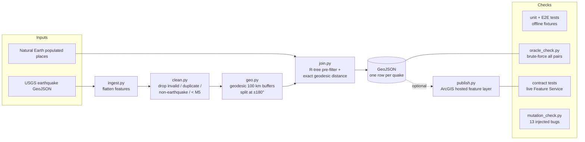
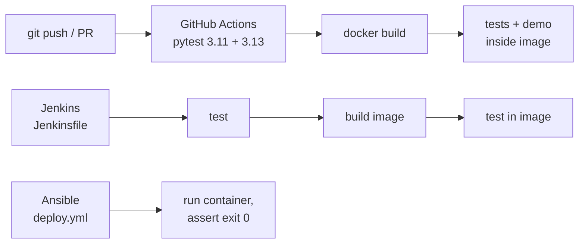

# DisasterResponse QA Kit

[](https://github.com/altitudedrawer/disaster-response-qa-kit/actions/workflows/ci.yml)

**Question:** which cities are within 100 km of M5+ earthquakes?

USGS earthquakes → clean → geodesic 100 km buffer → spatial join with city points → GeoJSON
→ (optional) ArcGIS hosted feature layer. The analysis is deliberately simple; the point of
the project is the testing and DevOps around it.

## Project scope

A focused portfolio project that emphasizes **test automation and DevOps rather than analytical
depth**: the spatial question is simple on purpose, so the effort goes into proving the answer
is right (unit, end-to-end, oracle, contract and mutation tests) and into running it the same
way everywhere (Docker, GitHub Actions, Jenkins, Ansible).

Built in 100 hours of hands-on work; the git history runs from 2026-10-20
to 2026-11-12 (see `docs/DEVLOG.md` and `docs/WORKFLOW.md`). Out of scope: shaking intensity,
population exposure, a front-end map.

## Architecture





## Quick start

```bash
# local (Python 3.11 via uv)
uv venv --python 3.11 .venv && source .venv/bin/activate && uv pip install -r requirements.txt
python -m pytest                                   # offline; contract tests auto-skip
python scripts/download_data.py --start 2025-10-20 --end 2026-10-20 --min-mag 5
PYTHONPATH=src python -m pipeline.run \
  --events data/raw/usgs_m5_2025-10-20_2026-10-20.geojson \
  --cities zip://data/raw/ne_10m_populated_places_simple.zip \
  --out output/m5_1yr.geojson
python scripts/oracle_check.py output/m5_1yr.geojson zip://data/raw/ne_10m_populated_places_simple.zip

# or Docker
docker build -t drqa:dev .
docker run --rm drqa:dev                                              # tests
docker run --rm -v "$PWD/output:/app/output" drqa:dev pipeline       # real data
```

Full step-by-step instructions (ArcGIS publish, Jenkins, Ansible, the experiment):
`docs/RUN_ON_YOUR_MACHINE.md`. Concepts for non-GIS readers: `docs/CONCEPTS.md`.

## Repository layout

| Path | Contents |
|---|---|
| `src/pipeline/` | `ingest`, `clean`, `geo`, `join`, `run` (CLI), `publish` (ArcGIS) |
| `tests/` | unit + E2E tests on committed fixtures; `tests/contract/` live-service tests |
| `scripts/` | `download_data.py`, `make_fixtures.py`, `oracle_check.py` |
| `experiments/llm_tests/` | LLM test-generation experiment: prompts, raw output, review sheet, scripts |
| `Dockerfile`, `.github/workflows/ci.yml`, `Jenkinsfile`, `jenkins/`, `ansible/` | DevOps |
| `docs/` | `CONCEPTS`, `RUN_ON_YOUR_MACHINE`, `JENKINS`, `DEVLOG`, `WORKFLOW`, `INTERVIEW`, `CHEATSHEET` |

## Data sources

Downloaded 2026-10-21 04:10 UTC with `scripts/download_data.py`; URLs, sizes and SHA-256
hashes are in `data/raw/MANIFEST.json` (gitignored with the data).

| Dataset | URL | Rows | License |
|---|---|---|---|
| USGS M5+ custom query, 2025-10-20 → 2026-10-20 | `earthquake.usgs.gov/fdsnws/event/1/query?format=geojson&starttime=2025-10-20&endtime=2026-10-20&minmagnitude=5` | 1,979 | US Government work, public domain |
| USGS M4.5+ past 30 days feed | `earthquake.usgs.gov/earthquakes/feed/v1.0/summary/4.5_month.geojson` | 655 | US Government work, public domain |
| Natural Earth 10m Populated Places (simple) | `naciscdn.org/naturalearth/10m/cultural/ne_10m_populated_places_simple.zip` | 7,342 | Public domain |
| GeoNames cities15000 (optional, `--geonames`; not used in results below) | `download.geonames.org/export/dump/cities15000.zip` | not downloaded | CC BY 4.0, attribution required |

Test fixtures (`tests/fixtures/`) are a 100-event / 200-city sample of the above plus labelled
synthetic edge cases; see `tests/fixtures/README.md`.

## Results (real data)

Measured 2026-10-21 in the project's Linux VM (arm64, Python 3.11.17). Your numbers will differ
if you download on another date, since the USGS feeds change.

| Run | Events in | Kept (M5+, valid) | Events with ≥1 city | Event–city pairs | Pipeline runtime |
|---|---|---|---|---|---|
| 1 year, M5+ | 1,979 | 1,978 | 563 | 1,118 | 0.19 s (3 runs: 0.191 / 0.188 / 0.187 s) |
| 30 days, M4.5+ feed filtered to M5+ | 655 | 176 | 56 | 112 | 0.09 s |

- 504 distinct cities lie within 100 km of at least one M5+ quake in the year.
- **Independent check:** `scripts/oracle_check.py` brute-forces all 1,978 × 7,342 geodesic
  distances (5.5 s, no spatial index) and found **0 mismatches** with the pipeline output.
- Runtime is `pipeline.run`'s internal timer (load → clean → join → write), excluding Python start-up.

## Test strategy

131 test cases + 8 contract tests; `python -m pytest` on 2026-11-12: **129 passed, 3 skipped**
(the skips are the contract module and two tests needing the optional `arcgis` package).

| Layer | Where | What it proves |
|---|---|---|
| Unit | `tests/test_{ingest,clean,geo,join,publish}.py` | Each rule in isolation: null/invalid/duplicate data, antimeridian, buffer accuracy (vertices within 1 m of 100 km), the 99.95 km edge case, dry-run validation, no credential leaks |
| End-to-end (offline) | `tests/test_pipeline.py` | CLI on 100 events × 200 cities; output compared with a **brute-force oracle** that checks every pair independently |
| Oracle on real data | `scripts/oracle_check.py` | Same idea on the real 1,978 × 7,342 run: 0 mismatches |
| Contract | `tests/contract/` | A live Feature Service has the fields, records, speed and error behaviour consumers rely on; auto-skips without `FEATURE_SERVICE_URL` |
| Mutation | `experiments/llm_tests/mutation_check.py` | Tests *fail on broken code*: our suite kills **13/13** injected bugs |
| Container / CI | `ci.yml`, `Jenkinsfile` | The same suite passes inside the Docker image, on Python 3.11 and 3.13 |
| Tooling | `tests/test_llm_experiment.py`, `tests/test_review_tool.py` | The experiment scripts compute rates correctly and refuse bad input |

Fixtures are real data (sampled with a fixed seed) plus clearly labelled synthetic edge
cases (`tests/fixtures/README.md`), so tests run offline in under a second.

## Design trade-offs

- **Geodesic buffers + exact distance, not degree circles.** A circle drawn in degrees is an
  ellipse on the ground (2× too wide at 60°N). Buffers are built on the WGS84 ellipsoid, padded
  slightly so the polygon *contains* the true circle, and every candidate is then checked with an
  exact geodesic distance. The polygon is just a fast filter; the distance decides.
- **Spatial index over brute force.** The R-tree join took 0.19 s on the 1-year run; the
  brute-force oracle took 5.5 s for the same answer. Brute force stays, but only as a check.
- **Left join.** Quakes with no nearby city stay in the output with `city_count = 0`.
- **`city_names` as a "; "-joined string,** because feature layers and shapefiles can't store lists.
- **Reject, don't repair.** Out-of-range coordinates are dropped and counted, never "fixed".
  Close-together events that might be duplicates are kept and documented, because merging
  them would be a guess.
- **`arcgis` is optional** (`requirements-publish.txt`): it's large and doesn't install on Linux
  arm64, so the core pipeline, tests and Docker image don't depend on it.
- **One Docker image, three commands** (`test` default, `demo`, `pipeline`), non-root user.
- **Poles out of scope:** a buffer containing a pole raises an error instead of returning a
  wrong polygon (no M5+ quake in the data was within 100 km of a pole).

## Problems encountered

Found by profiling the real downloads before running the pipeline:

1. **A "M5.2 earthquake" that is a landslide.** The USGS M5+ query returned `us7000tbwb`
   (type `landslide`, Nepal). *Fix:* `clean.py` drops rows whose USGS `type` isn't
   `earthquake` (counted as `non_earthquake`); test `test_non_earthquake_types_dropped_but_missing_type_kept`.
2. **Ambiguous city names.** Natural Earth has 242 repeated names (Aberdeen UK vs Aberdeen US).
   *Fix:* output uses `"name (country)"` labels, e.g. `Labasa (Fiji)`.
3. **Natural Earth lat/lon columns disagree with the geometry** by >0.01° for 301 of 7,342 places
   (up to 0.73°, e.g. Juina, Brazil). Spot checks showed the geometry is right. *Decision:* the
   pipeline only ever uses the point geometry; noted in `ingest.load_cities`.
4. **Possible double-counting of one quake under two IDs, investigated and NOT deduplicated.**
   19 pairs of events occur < 60 s and < 0.5° apart, but they have different magnitudes and are
   2–18 km apart (e.g. M5.4 then M7.3 six seconds later near Luganville, Vanuatu). These look
   like foreshock/mainshock sub-events, so merging them would be a guess. Limitation: a
   per-*city* risk summary would count such a city twice.
5. **What did *not* happen:** no null magnitudes, null/invalid coordinates or duplicate IDs in
   these USGS downloads. The cleaning rules for those are still tested with synthetic fixtures,
   because other date ranges or sources could contain them.
6. **Antimeridian on real data:** 29 events have |lon| > 179°; 1 of them has a city in range.
   All are covered by the oracle check above.
7. **Mixed magnitude types** (`mww` 1,127, `mb` 823, `ml` 15, others 13): "M5" means slightly
   different things across scales. Not corrected; noted as a limitation.
8. **Docker: `entrypoint.sh: Permission denied`.** Source files on the host were mode 0600,
   `COPY` preserves modes, and `chmod +x` adds execute but not *read*, so the non-root user
   couldn't run the script. *Fix:* `COPY --chown/--chmod` explicitly.
9. **Docker: can't write a mounted `output/` on Linux.** The container's uid 10001 doesn't own
   the host folder. *Fix:* `data/` and `output/` are mode 1777 in the image, and the docs (and the
   Ansible playbook) run the container as the host user. Verified with an arbitrary uid.
10. **Jenkins: `/build` returns HTTP 400 after the first run,** because the job is now
    parameterized. Use `/buildWithParameters`.
11. **ArcGIS account blocked by university SSO.** Signing in to `usc.maps.arcgis.com` with USC
    SSO fails with Microsoft error `AADSTS50105` (an app restricted to assigned users). The
    real publish is waiting on USC's Spatial Sciences Institute; all publish code is tested
    without an account (dry run, fake `arcgis` objects, live contract tests against a public layer).
12. **Silent data corruption risks in the experiment tooling.** A saved LLM reply wrapped in
    Markdown fences, a file name with a dot (`4.1flash_clean_v1.py` can't be imported), and
    running outside the project venv would each have recorded every generated test as "not
    green" without any error. *Fix:* `prefill_sheet.py` refuses all three, with a test per case.
13. **Two real bugs found by LLM-generated tests** (details under *LLM test-generation
    experiment*): `geodesic_distance_m` crashed on scalar-vs-array input despite its docstring,
    and `nearest_km` used numpy rounding (12.345 → 12.34 instead of 12.35). Both fixed, each
    with a regression test in `tests/`.

## Publishing to ArcGIS

`python -m pipeline.publish <geojson> --dry-run` validates and prepares without logging in.
The real publish uses ArcGIS API for Python 2.4.4 with credentials from environment variables
only. Live contract tests in `tests/contract/` auto-skip unless `FEATURE_SERVICE_URL` is set.

Status: dry run, the publish call sequence (against fake `arcgis` objects, plus a signature
check against the real 2.4.4 package) and the contract-test harness (against Esri's public
Living Atlas earthquake layer) are tested. **The real publish has not been run**: it's
waiting on an ArcGIS account (see problem 11). TODO: run it and record the result here.

## DevOps

| File | What it does | Status |
|---|---|---|
| `Dockerfile`, `docker/entrypoint.sh`, `.dockerignore` | One image; `test` (default), `demo`, `pipeline` | **VERIFIED**: built and ran all 3 commands (sandbox, x86_64); `test` also verified on the author's Mac with Docker Desktop (81 passed, 3 skipped at the time). Image is 615 MB on disk, 142 MB compressed. Runs as non-root; a fake `.env` in the build context is absent from the image |
| `.github/workflows/ci.yml` | pytest on 3.11 + 3.13, JUnit artifacts, Docker build + tests in image | **VERIFIED** on GitHub: run CI #1 (commit `8826824`, 2026-10-29) passed in 1m 0s. Also lint-clean with actionlint 1.7.12 |
| `Jenkinsfile`, `jenkins/Dockerfile`, `docs/JENKINS.md` | checkout → install → test → (contract) → build image → test in image | **VERIFIED** in Jenkins LTS in Docker: a green build (81 tests in the report at the time) and a red build (failing test blocks the image build). Contract stage UNTESTED |
| `ansible/deploy.yml` | Get image, run the container once, assert success | **VERIFIED** with a local image, as a non-root user. `drqa_pull=true` (registry) path UNTESTED |

## LLM test-generation experiment

`experiments/llm_tests/`: can an LLM write useful pytest cases from **only** function signatures
and docstrings? Protocol, rules and the disclosed v1.1 amendment are in its README.

- Generator: DeepSeek-V4.1-Flash-1017, one shot per module, 4 modules → **62 tests**;
  59 passed unmodified on the code as it was then.
- **It found 2 real bugs** in our code (scalar-vs-array broadcasting, half-way rounding), now fixed.
- Mutation check: the generated tests kill **12 of 13** injected bugs; the survivor is M03, the
  inscribed-polygon edge case (cities at ~99.9 km), which our own suite catches. Our suite: 13/13.
- **Acceptance rate: [X]% (95% CI [X]%–[X]%), usable rate [X]%** (TODO: from `acceptance_rate.py`
  after the human review of all 62 tests; not computed yet).

## AI assistance / My contribution

**AI tools used:**
- **Claude** (Anthropic, through the Claude desktop app's Cowork mode): wrote most of the code,
  tests and docs; ran the verification runs in its own sandbox and in a Linux VM on my machine;
  looked up the ArcGIS and USC documentation.
- **DeepSeek-V4.1-Flash-1017:** used only as the *subject* of the LLM test-generation experiment.

**What I did myself:**
- Defined the project, its phases and the honesty rules (no invented numbers; label everything
  VERIFIED / SYNTAX-CHECKED / UNTESTED; real git history only).
- Ran everything on my own Mac: the test suite, Docker Desktop (`docker run` → 81 passed at the
  time), GitHub Actions (checked the first CI run), and the whole LLM generation step.
- Debugged my own setup: the repo moved into a subfolder, a `.gitignore` left behind before the
  first push, untracking committed data and cache files, the USC ArcGIS SSO block.
- Made the judgement calls: the v1.1 protocol amendment, fixing our rounding rather than
  editing the test, running the mutation check, using git commit dates in the dev log.
- Made every commit, and will make every accept/edit/reject decision in the review sheet.
- [ ] Reviewed all 62 generated tests (pending)

## Honest limitations

- Buffers containing a pole raise an error (no M5+ quake was within 100 km of a pole in this data).
- Distance is to the epicentre; it ignores depth, fault extent and actual shaking intensity.
- City points, not city areas or population exposure.
- Magnitude types are mixed (`mww`, `mb`, …), so "M5" isn't one consistent scale.
- The real ArcGIS publish, the Jenkins contract stage and Ansible's registry-pull path are untested.
- The LLM experiment covers one model, one prompt, one shot, and is self-graded (see its README).
